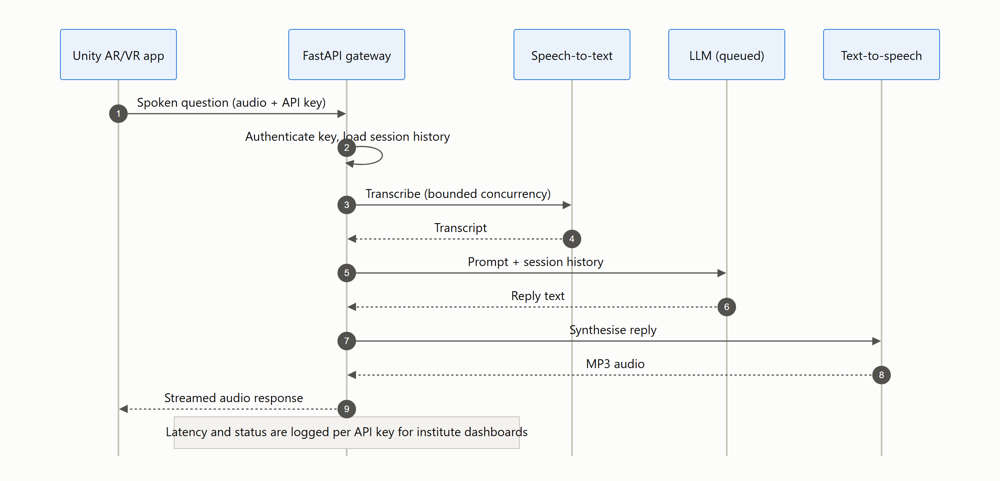
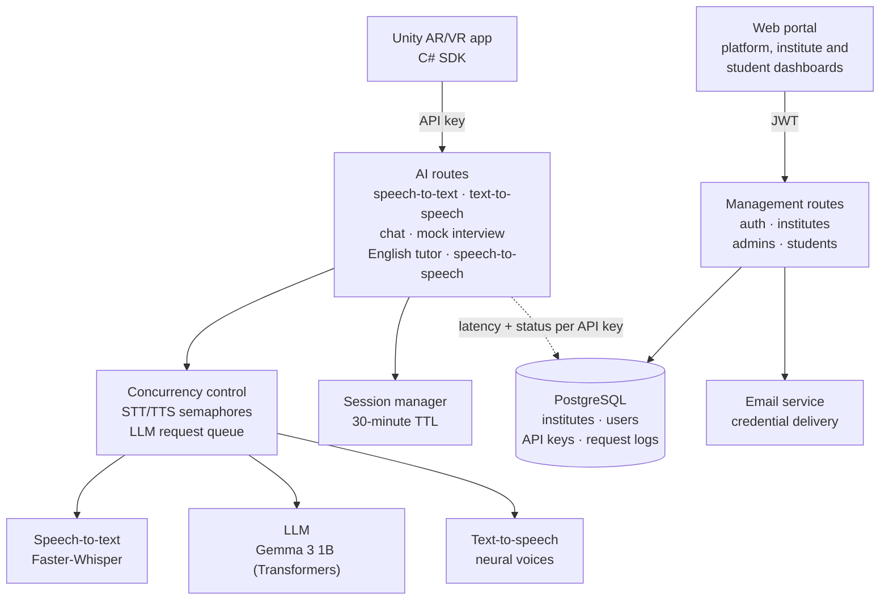

# VoxServe: Speech and LLM Inference Platform

A multi-tenant FastAPI platform that serves self-hosted speech-to-text, LLM chat and text-to-speech to AR/VR training institutes, with GPU-aware queuing, automatic GPU-to-CPU fallback and a Unity SDK.


> **Note:** The source code is private. This repository documents the architecture, design decisions and results. I'm happy to walk through the implementation in an interview.

<picture>
  <source media="(prefers-color-scheme: dark)" srcset="assets/speech-to-speech-dark.png">
  
</picture>

---

## Overview

Students on AR/VR diploma courses need to practise spoken English, rehearse technical interviews and ask questions about their subject, ideally from inside the AR/VR apps they're learning to build. Each institute also needs to manage its own students and see how the tools are used.

VoxServe puts self-hosted speech recognition, a language model and neural text-to-speech behind one API. Unity apps call it through a C# SDK, and a role-based web portal lets the platform owner manage institutes, institute admins manage their students within a quota, and students manage their own access. Every request is logged per API key, so each institute can see its own usage.

## Key Features

- **Speech-to-text:** upload audio and get a transcript (Faster-Whisper, `medium.en`).
- **Text-to-speech:** text in, MP3 out, with eight neural voices across US, UK and Indian English.
- **Chat assistant:** session-aware chat focused on AR/VR topics, with conversation history kept for 30 minutes.
- **Mock technical interviews:** start, answer and receive feedback on AR/VR interview questions.
- **English tutor:** conversational practice with corrections and per-student progress tracking.
- **Speech-to-speech in one call:** audio in, transcription, LLM reply and synthesised speech out, streamed back to the app.
- **Multi-tenant portal:** platform owner, institute admins (with student quotas) and students, each with their own dashboard, plus per-user API keys.
- **Unity C# SDK:** speech-to-text, chat, text-to-speech, speech-to-speech and interview feedback from inside AR/VR apps.

## Architecture



## How It Works

1. A Unity app (or the web portal's test console) calls an AI route with its API key.
2. Speech-to-text and text-to-speech requests pass through semaphores that cap how many run at once; LLM requests join a queue that serialises access to the GPU.
3. Chat, interview and tutor flows load the user's session, so the model sees the conversation so far.
4. Each service runs its model on the GPU when one is available and validated, and falls back to the CPU automatically when it isn't.
5. Speech-to-speech chains all three models in one request and streams the audio reply back.
6. A middleware layer records the type, latency and status of every request against its API key, which powers per-institute and per-student dashboards.

## Results

| Metric | Value |
|---|---|
| Speech-to-text latency | ~3 s |
| LLM reply latency | ~2–3 s |
| Text-to-speech latency | ~1–2 s |
| Concurrent users supported | 8–12 |
| Deployment targets | Windows workstation and Ubuntu server, from the same codebase |

The latency and concurrency figures are the typical values documented for the platform during development; they are not from a formal load test.

## Tech Stack

| Category | Tools |
|---|---|
| API | FastAPI, Uvicorn, Pydantic v2, pydantic-settings |
| Models | Faster-Whisper (CTranslate2), Gemma 3 1B instruction-tuned via Hugging Face Transformers and PyTorch, Edge-TTS neural voices |
| Data | PostgreSQL, SQLAlchemy 2.0 |
| Security | JWT sessions, per-user API keys, bcrypt password hashing, role-based access control |
| Clients | Unity C# SDK, HTML/CSS/JavaScript portal |
| Deployment | PowerShell and Bash installers, `uv`-managed virtual environment, systemd service, Nginx reverse proxy |

## Engineering Decisions

- **Queue the GPU, bound everything else:** one GPU can't run several LLM generations well at once, so LLM requests are serialised through an async queue, while speech-to-text and text-to-speech use semaphores so bursts can't exhaust memory.
- **Fall back instead of failing:** GPU support breaks in quiet ways, such as a missing CUDA runtime library on Windows. The services check for the runtime and validate it before loading, and drop to CPU automatically if anything is wrong:

  ```mermaid
  flowchart LR
      Start["Model service starts"] --> Detect{"CUDA GPU<br/>available?"}
      Detect -->|"yes"| DLL["Find and validate<br/>CUDA runtime libraries"]
      DLL -->|"valid"| GPU["Load on GPU<br/>LLM FP16 · Whisper float16"]
      DLL -->|"missing or broken"| CPU["Load on CPU<br/>LLM FP32 · Whisper INT8"]
      Detect -->|"no"| CPU
      GPU --> Serve["Serve requests"]
      CPU --> Serve
  ```

- **Respect the model's chat template:** Gemma expects strictly alternating user and assistant turns with no separate system role, so conversation histories are reshaped to fit the template instead of being passed through as-is.
- **Quotas enforced in two places:** the institute → admin → student hierarchy and each admin's student quota are enforced both in the database model and in the route dependencies.
- **Analytics without per-endpoint code:** one middleware classifies every AI request by type and records its latency and status, so new endpoints are measured automatically.
- **One-command setup on two operating systems:** matching PowerShell and Bash installers set up the environment, GPU runtime packages and database, so the same platform runs on a Windows workstation or an Ubuntu server.

## My Role

I designed and built the platform end to end: the FastAPI services and model integration, the concurrency and GPU-fallback logic, the multi-tenant data model and role-based portal, the request analytics, the Unity C# SDK, and the Windows and Linux deployment tooling.

## Contact

**Zayed Makandar** | [zayedmakandar03@gmail.com](mailto:zayedmakandar03@gmail.com) | [LinkedIn](https://www.linkedin.com/in/zayed-makandar-642536422/) | [Portfolio](https://zayedmakandar.com)
